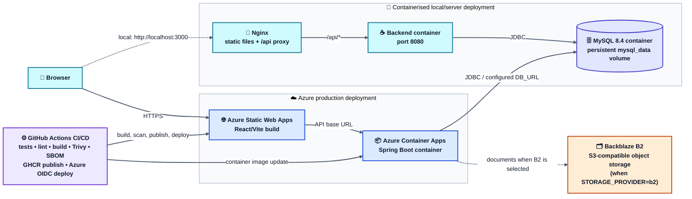
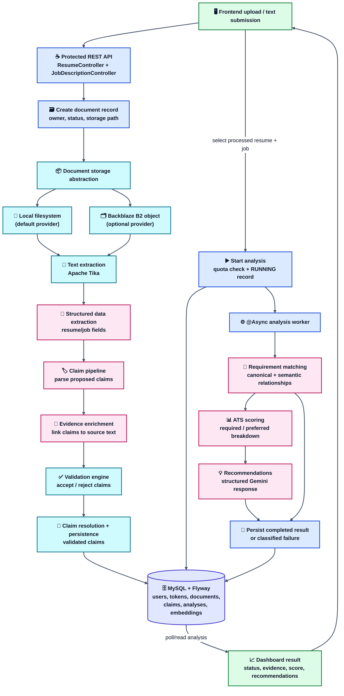

# RoleNexa System Architecture

RoleNexa is a React application backed by a Spring Boot REST API. It lets an
authenticated user upload a resume and a target job description, extracts
structured and evidence-backed claims, evaluates requirement coverage, and
returns an ATS-style score with recommendations. The diagrams below describe
the implemented architecture and data flow; they do not imply additional
product capabilities.

## 1. Runtime and deployment overview

The repository also provides Docker Compose files for MySQL, the backend, and
the Nginx-served frontend. The Azure path is implemented by the `main` branch
workflow: it publishes the backend image to GHCR, updates Azure Container Apps,
and deploys the built frontend artifact to Azure Static Web Apps. No Azure
managed MySQL service is defined in this repository; the database is shown as
the configured MySQL dependency rather than assigned to an unimplemented
cloud product.

## 2. Frontend, authentication, and protected API

```mermaid
%%{init: {"theme":"base","themeVariables":{"fontFamily":"Inter,Segoe UI,Arial,sans-serif","fontSize":"20px","primaryTextColor":"#0f172a","lineColor":"#334155","edgeLabelBackground":"#ffffff","clusterBkg":"#f8fafc","clusterBorder":"#64748b","nodeBorder":"#334155","nodeTextColor":"#0f172a"},"flowchart":{"nodeSpacing":70,"rankSpacing":95,"padding":28,"htmlLabels":true}}}%%
flowchart LR
    subgraph FE["🖥️ React + TypeScript frontend"]
        UI["🖥️ User interface<br/>React Router • Tailwind • Zustand"]
        AuthPages["📝 Registration / Login"]
        Dashboard["📊 Protected dashboard<br/>resumes • jobs • analyses"]
        Uploads["📄 Resume upload<br/>Job description upload or text"]
        Results["📈 Analysis status and results<br/>match evidence • ATS score • recommendations"]
        Session["🎟️ Auth session<br/>access + refresh token storage"]
    end

    subgraph Security["🔐 Authentication and authorization"]
        PublicAuth["🔓 Public auth routes<br/>register • login • refresh • logout"]
        JWT["🔑 JWT service<br/>15-minute access token<br/>7-day refresh token"]
        Filter["Spring Security<br/>Bearer JWT filter"]
        Principal["👤 Current user principal<br/>owner-scoped authorization"]
        RefreshDB[("🗄️ Refresh-token records<br/>hashed + revocable")]
    end

    subgraph API["☕ Spring Boot REST API"]
        AuthAPI["🔐 AuthController"]
        ProtectedAPI["☕ Protected controllers<br/>resume • job description • analysis • user"]
        Services["🧩 Application services<br/>validation • quota • persistence"]
    end

    AuthPages -->|credentials| PublicAuth
    PublicAuth --> AuthAPI
    AuthAPI --> JWT
    JWT -->|access + refresh tokens| Session
    JWT --> RefreshDB
    Session -->|restore session / refresh| PublicAuth
    Session -->|Authorization: Bearer access token| Filter
    Filter -->|valid token| Principal
    Principal --> ProtectedAPI
    UI --> Dashboard
    Dashboard --> Uploads
    Uploads -->|multipart or text API request| ProtectedAPI
    ProtectedAPI --> Services
    Services -->|status / result response| Results
    Results --> Dashboard

    linkStyle default stroke:#475569,stroke-width:2px
    classDef frontend fill:#dcfce7,stroke:#15803d,color:#0f172a,stroke-width:2px,font-weight:600
    classDef security fill:#fef3c7,stroke:#b45309,color:#0f172a,stroke-width:2px,font-weight:600
    classDef backend fill:#dbeafe,stroke:#1d4ed8,color:#0f172a,stroke-width:2px,font-weight:600
    classDef persistence fill:#ede9fe,stroke:#6d28d9,color:#0f172a,stroke-width:2px,font-weight:600
    class UI,AuthPages,Dashboard,Uploads,Results,Session frontend
    class PublicAuth,JWT,Filter,Principal security
    class AuthAPI,ProtectedAPI,Services backend
    class RefreshDB persistence
```

Registration hashes passwords and rejects compromised passwords. Login issues
an access token and stores a hash of the refresh token. Refresh-token rotation
revokes the old record before issuing a new pair; logout revokes the active
refresh token. Protected controllers receive the authenticated principal and
perform owner-scoped lookups before reading or mutating user documents and
analyses.

## 3. Resume/job processing and analysis pipeline

Document processing and analysis are separate stages. Upload processing reads
the stored document, extracts text, creates structured data, resolves validated
claims, and stores them. Starting an analysis creates a running record and
dispatches the worker asynchronously; the worker matches the selected job
requirements to validated resume claims, calculates ATS scores, asks Gemini for
evidence-based recommendations, and persists the final serialized result.
Failures are classified and persisted with retryability metadata.

## 4. AI and LLM responsibilities

```mermaid
%%{init: {"theme":"base","themeVariables":{"fontFamily":"Inter,Segoe UI,Arial,sans-serif","fontSize":"15px","primaryTextColor":"#0f172a","lineColor":"#475569","edgeLabelBackground":"#ffffff","clusterBkg":"#f8fafc","clusterBorder":"#94a3b8"}}}%%
flowchart LR
    Text["📄 Extracted resume / job text"]
    Structured["🧾 Structured resume or job description"]
    GeminiChat["✨ Google Gemini chat<br/>Spring AI Google GenAI"]
    GeminiEmbed["🧠 Google Gemini embeddings<br/>(configured embedding provider)"]
    Ollama["🦙 Ollama embeddings<br/>(default local embedding provider)"]
    EmbeddingService["🔢 EmbeddingService<br/>batch vector generation"]
    RIE["🔗 Requirement evaluation<br/>expression building + coverage"]
    Semantic["🧠 Semantic batch classifier<br/>relationship classification"]
    ATS["📊 Deterministic ATS scoring<br/>requirement score aggregation"]
    RecPrompt["💬 Recommendation prompt<br/>uses ATS evaluation only"]
    Recommendations["💡 Structured recommendations<br/>strengths, gaps, actions"]
    Claims["🏷️ Claims and evidence<br/>validated canonical facts"]

    Text -->|understand| GeminiChat
    GeminiChat --> Structured
    Structured --> Claims
    Claims --> RIE
    RIE -->|requirement components + claim names| EmbeddingService
    EmbeddingService --> GeminiEmbed
    EmbeddingService --> Ollama
    GeminiEmbed -->|vectors| RIE
    Ollama -->|vectors| RIE
    RIE --> Semantic
    Semantic -->|semantic relationships| ATS
    ATS --> RecPrompt
    RecPrompt --> GeminiChat
    GeminiChat --> Recommendations

    linkStyle default stroke:#334155,stroke-width:3px
    classDef ai fill:#fce7f3,stroke:#be185d,color:#0f172a,stroke-width:3px,font-weight:700
    classDef process fill:#cffafe,stroke:#0e7490,color:#0f172a,stroke-width:3px,font-weight:700
    classDef data fill:#fef3c7,stroke:#b45309,color:#0f172a,stroke-width:3px,font-weight:700
    class Text,Structured,Claims,Recommendations data
    class GeminiChat,GeminiEmbed,Ollama,EmbeddingService,Semantic ai
    class RIE,ATS,RecPrompt process
```

Gemini chat is used for document understanding and for generating the
structured recommendation response. Embeddings support semantic matching
between requirement components and canonical resume claims; the configured
provider is selectable through `EMBEDDING_PROVIDER` (`ollama` by default, with
Gemini configured as an available Spring AI provider). Requirement matching
combines structured/canonical matching with embedding-assisted semantic
relationships. ATS scoring itself is deterministic and aggregates the
requirement match results; Gemini recommendations are constrained to that ATS
evaluation rather than recalculating it.

## Legend and implementation boundaries

| Colour | Meaning |
|---|---|
| Green | Frontend and user-facing UI |
| Amber | Authentication, security, and token lifecycle |
| Blue | Spring Boot API and application processing |
| Pink | AI/LLM, embeddings, and semantic classification |
| Purple | Persistence, storage, and deployment infrastructure |
| Orange | External providers and object storage |

Solid arrows represent implemented request, response, persistence, or
processing flow. Dashed arrows represent an optional/configuration-dependent
connection. Local filesystem storage and Ollama embeddings are implemented
alternatives; Backblaze B2 and Gemini embeddings are implemented integrations
selected by configuration. No separate queue, vector database, or additional
cloud service is part of the current repository architecture.

The diagrams use Mermaid-rendered Unicode symbols for familiar component cues
(`🗄️` database, `🧠` LLM/semantic processing, `🔐` security, `☁️` cloud, and
`⚙️` automation). Database nodes also use Mermaid's native cylinder shape.
This keeps the document self-contained without relying on an external icon
font that may render inconsistently across Markdown viewers.

### Implementation evidence

The views reflect the current `frontend/src`, Spring modules under
`backend/src/main/java`, Flyway migrations under
`backend/src/main/resources/db/migration`, `application.yaml`, Docker Compose
files, and `.github/workflows/ci.yml`. Features described as planned or
future-facing elsewhere in project documentation are intentionally not added
to these diagrams unless backed by those implementation files.
